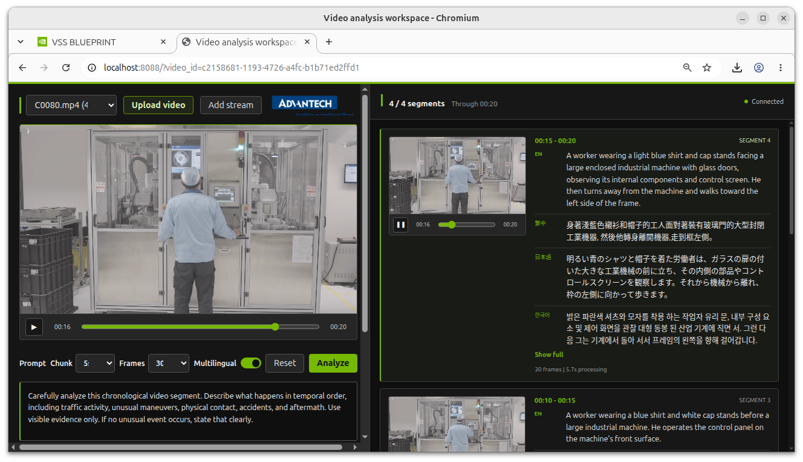
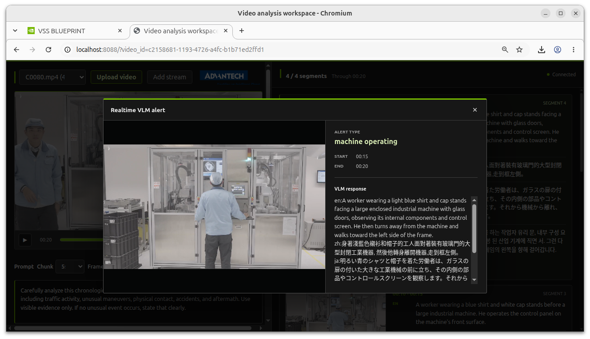

# VSS Live Insight and Alert

VSS Live Insight and Alert is an Advantech web application built on **NVIDIA VSS 3.2.1**. It analyzes live RTSP streams and uploaded videos with a vision language model (VLM), shows a description for each video segment, and raises real-time alerts on the events you describe.

It is delivered as an **offline bundle** together with **VSS 3.2.1 — Jetson AGX Thor Edition** (**LVS (Long Video Summarization)** profile) and a local LLM. The installation downloads everything once; after that, the whole stack runs without an internet connection. The two applications work as a pair:

| Feature | VSS Live Insight & Alert | VSS 3.2.1 (LVS) |
| --- | --- | --- |
| **Main Focus** | Real-time monitoring | Deep analysis |
| **User Interface** | Developed by Advantech | NVIDIA VSS native |
| **Video Input** | Live streams & uploaded videos | Live streams & uploaded videos |
| **Output** | Instant alerts & clip notes | Full reports & timed event summaries |



## Key Features

* **Live Stream Analysis**: Analyzes live RTSP streams and shows a live preview in the browser through WebRTC.
* **Video File Analysis**: Upload a video file and analyze it segment by segment.
* **Segment Descriptions**: Shows each video segment together with its VLM description.
* **Real-Time Alerts**: Shows a pop-up window when the VLM detects an event you describe.
* **Flexible Settings**: Configure the chunk duration, frame count, prompt, alerts, and translation from the UI.
* **Caption Translation**: Translates English descriptions into Traditional Chinese, Japanese, and Korean.
* **Offline Operation**: All container images and models are installed locally, and the whole stack starts automatically at boot without an internet connection.



## System Architecture

The offline bundle installs three Docker Compose projects, started in this order at boot by `vss-offline.service`:

1. **`qwen38-llm`** — the local LLM (*Qwen3.8-27B-NVFP4*, served by vLLM) used by VSS.
2. **`mdx`** — VSS 3.2.1 with the LVS profile.
3. **`vss-live-insight`** — this application:
   * **`vss-live-insight`** — the web application and its backend. It sends video segments to the VLM, shows the results, and raises alerts.
   * **`vss-translation-service`** — translates the English descriptions. Its translation models are kept in a Docker volume.

## Installation Guide

### Prerequisites

**Hardware and OS**

* MIC-743 (Jetson AGX Thor) with JetPack 7.1, **Jetson Linux R38.4.0**.
* At least **250 GB** of free disk space.

**Network (installation only)**

* Access to GitHub, the apt repositories, and `get.docker.com`.
* Access to Docker Hub, where the bundle images are hosted: [`ispsae/vss-3.2.1-offline-bundle`](https://hub.docker.com/r/ispsae/vss-3.2.1-offline-bundle).

### 1. Check the Host

Confirm that the system is Jetson Linux R38.4.0:

```bash
head -1 /etc/nv_tegra_release
```

### 2. Get the Installation Scripts

```bash
git clone https://github.com/advantech-EdgeAI/VSS-Live-Insight-and-Alert.git ~/offline-bundle-261001
cd ~/offline-bundle-261001
```

### 3. Prepare the Host

Run `setup-host.sh` with `sudo`. Keep `lib-common.sh` in the same directory; `setup-host.sh` needs it.

```bash
sudo ./setup-host.sh
```

It is safe to run again; steps that are already done are skipped. At the end, answer `y` to reboot. After the reboot, confirm that the fan is running, then check the host:

```bash
docker info | grep "Default Runtime"   # must be nvidia
groups | grep docker                    # mic-743 must be in the docker group
sudo nvpmodel -q                        # last line must be 0 (MAXN)
```

### 4. Download the Images

```bash
cd ~/offline-bundle-261001
./pull.sh
```

This downloads all container images and models from `docker.io/ispsae/vss-3.2.1-offline-bundle` and takes about 1.5 to 2 hours. The last line must be `failed=0`. If the download stops or fails, run `./pull.sh` again; images that are already downloaded are skipped.

### 5. Install

```bash
./install.sh
```

This restores the configuration, places the models, creates the containers, sets up `vss-offline.service`, and starts all services. It takes about 20 minutes and asks for the `sudo` password once. The installation is complete when you see `Installed.`

After this step, no internet connection is needed.

## Usage / Quick Start

### 1. Start the Application

All services start automatically at boot, in the order LLM → VSS → Live Insight. No manual step is needed.

About 5 minutes after the installation or a reboot, check the service status. There must be **21** containers with the status `Up`:

```bash
docker ps --format '{{.Names}}\t{{.Status}}' | sort
```

### 2. Open the Web UI

On the Jetson device:

* **Live Insight (this application)**: `http://127.0.0.1:8088/`
* **Agent UI (VSS reports)**: `http://127.0.0.1:3000/`
* **VST**: `http://127.0.0.1:30888/vst/`

### 3. Analyze a Video or Stream

* **Video file** — upload a video in the application and start the analysis.
* **Live stream** — add a camera with its RTSP URL.

Before you start, set the chunk duration, frame count, prompt, alert rules, and translation language in the UI. Each video segment then appears with its description, and matching events show up as alert pop-ups.

### 4. Manage the Application

These commands do not need an internet connection:

```bash
# Start all services (for example, after a manual stop)
sudo systemctl start vss-offline.service

# Stop all services
docker compose -p vss-live-insight stop; docker compose -p mdx stop; docker compose -p qwen38-llm stop

# Show service status
docker ps --format '{{.Names}}\t{{.Status}}' | sort
```

## Troubleshooting

### A Service Did Not Start

Check which containers are running, then follow the logs of the one that is not `Up`:

```bash
docker ps -a --format '{{.Names}}\t{{.Status}}' | sort
docker logs -f <container_name>
```

If services are missing after a reboot, check the boot service, then start it again:

```bash
systemctl status vss-offline.service --no-pager
sudo systemctl start vss-offline.service
```

### The VSS Report Is Empty

The VLM container started before Kafka. Make sure `kafka` is running, then restart the VLM container:

```bash
docker logs vss-rtvi-vlm 2>&1 | grep -E "NoBrokersAvailable|producer not available"
docker restart vss-rtvi-vlm
```

### `Missing decoder: H.264`

`nvidia-l4t-gstreamer` is not installed on the host. Install it with `sudo apt install -y nvidia-l4t-gstreamer` (`setup-host.sh` in Installation Guide, Step 3 installs it), delete the GStreamer cache inside the affected container (`~/.cache/gstreamer-1.0/registry.*.bin`), then restart that container.
